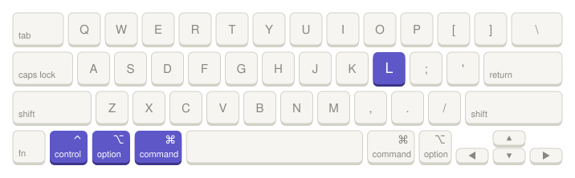

# Open in Linear

Highlight any text on your Mac and press **⌃⌥⌘L**. (control+option+command+L)

<picture>
  <source media="(prefers-color-scheme: dark)" srcset="assets/shortcut-dark.svg">
  
</picture>

- A ticket ID like `ENG-123` opens that issue in Linear.
- Anything else searches Linear for it.

## Install

```bash
git clone https://github.com/jordaniscrosby/open-in-linear.git
cd open-in-linear
./install.sh
```

It asks for your Linear workspace and lets you keep the default shortcut or pick your own. Run it again to change either one. To remove it, run `./uninstall.sh`.
